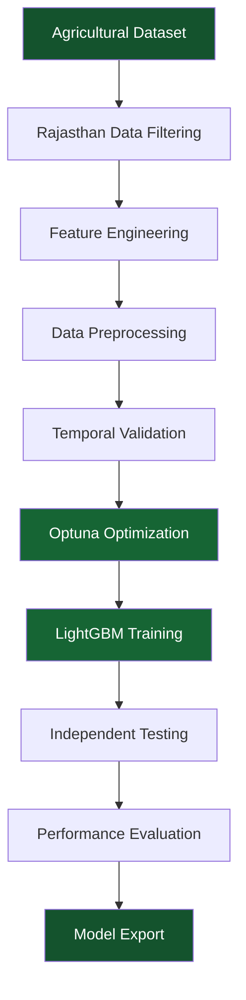

# AgriStorm Sentinel

<div align="center">


### AI-Powered Crop Yield Vulnerability Prediction for Rajasthan, India

Predicting historical crop yield changes using machine learning, temporal validation and hyperparameter optimization.

<br/>


</div>

---

## About The Project

**AgriStorm Sentinel** is a machine learning project focused on agricultural yield vulnerability prediction in Rajasthan, India.

Model 2.4 uses LightGBM regression combined with Optuna hyperparameter optimization to predict historical crop yield changes from agricultural and environmental features.

The system uses temporal validation to evaluate model performance on unseen historical years.

## Model 2.4 – Key Features

- LightGBM regression model
- Optuna hyperparameter optimization
- 40 optimization trials
- Expanding-window temporal validation
- Numerical and categorical preprocessing
- Independent temporal testing
- Crop-wise performance evaluation
- Feature importance analysis
- Model serialization and verification
- Baseline performance comparison

## Technology Stack

| Technology | Purpose |
|---|---|
| Python | Core programming |
| LightGBM | Gradient boosting regression |
| Optuna | Hyperparameter optimization |
| Scikit-learn | Preprocessing and evaluation |
| Pandas | Data manipulation |
| NumPy | Numerical operations |
| SciPy | Sparse matrix utilities |
| Joblib | Model serialization |

## Model Workflow



## Temporal Validation Strategy

The model follows a chronological training and testing approach.

| Stage | Crop Years |
|---|---|
| Training | Up to 2007 |
| Temporal validation | 2005, 2006, 2007 |
| Independent testing | 2008–2010 |
| Optuna trials | 40 |

This approach helps evaluate the model on historical years that are not included in its final training dataset.

## Model Evaluation

The model calculates the following metrics:

| Metric | Description |
|---|---|
| MAE | Mean Absolute Error |
| RMSE | Root Mean Squared Error |
| R² | Coefficient of Determination |
| Baseline MAE | Median-based baseline error |
| MAE Improvement | Improvement over baseline |

Actual metric values are generated when the model is executed.

## Generated Outputs

```text
AgriStorm_Model_2_V2_4/
│
├── model/
│   └── crop_vulnerability_lgbm.pkl
│
├── evaluation/
│   ├── predictions.csv
│   ├── crop_wise_performance.csv
│   └── feature_importance.csv
│
└── reports/
    └── model_report.json
```

## Dataset Requirements

The model expects a previously prepared Pandas DataFrame named `df` and a feature list named `FEATURES`.

Required columns:

- `yield_change_pct` – Prediction target
- `crop_year` – Historical crop year
- `state` – State filtering
- `district_key`
- `dominant_crop`
- `season`

The dataset must contain the required feature columns used by the preprocessing pipeline.

## Important Limitations

- Predicts historical yield change, not directly observed crop damage.
- Evaluation is restricted to Rajasthan and the available historical period.
- Independent validation is required before real-world deployment.

## Project Information

| Detail | Information |
|---|---|
| Project | AgriStorm Sentinel |
| Model Version | 2.4 |
| Algorithm | LightGBM + Optuna |
| Region | Rajasthan, India |
| Task | Regression |
| Validation | Temporal Validation |

## Author

**Priyanshu Kumar Verma**

---

<div align="center">


**AgriStorm Sentinel | Model 2.4**

*Machine Learning for Agricultural Intelligence*

</div>
